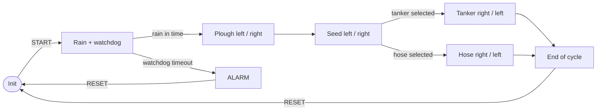

# PLC Precision-Irrigation Automation

**Sequential Function Chart Automation of a Precision-Irrigation Field Process**

A Beckhoff TwinCAT 3 PLC runs the field cycle (rain, ploughing, seeding, and irrigation by water tanker or hose sprinkler) as an IEC 61131-3 Sequential Function Chart. The PLC state is mirrored live to a C# HMI over ADS and published through an OPC UA server to an iFIX SCADA.

## The problem

A field cycle is a strict sequence of movements: lower the rain cloud, plough left and back, seed left and back, then irrigate with one of two machines. Each movement must start only once the previous one has physically finished. The process must not hang silently when an actuator or sensor fails. Its state must also be visible to an operator HMI and to external supervisory systems.

## Approach

| | |
|---|---|
| **Control logic** | `PROGRAM MAIN` written as an SFC in TwinCAT 3. Step actions and transition conditions are written in Structured Text. |
| **Sequencing** | Every movement is closed by a limit switch: the step is left when its end-of-travel sensor becomes TRUE, so no fixed time delays are used. |
| **Branching** | Two alternative branches: *rain delivered vs. watchdog abort* after the rain step, and *water tanker vs. hose sprinkler* for irrigation. |
| **Supervision** | A `TON` watchdog (5 s preset) runs while the PLC waits for rain. On timeout the SFC takes a dedicated alarm branch, and only RESET brings it back to `Init`. |
| **HMI** | C# WinForms application using `TwinCAT.Ads`. It registers on-change ADS notifications for all 24 PLC variables, writes values back through variable handles, and animates the field as a plant simulator. |
| **Connectivity** | TwinCAT OPC UA Server serving the PLC variables through Data Access, with read-only guest access (the Historical Access and Alarms & Conditions modules are present but unused). PLC variables are published through `{attribute 'OPC.UA.DA' := '1'}` pragmas. |
| **SCADA** | iFIX connected to the OPC UA server as a client, for supervision of the process variables. |



The full step/transition breakdown, reconstructed from the TwinCAT XML, is in [`snippets/02_sfc_structure.md`](snippets/02_sfc_structure.md).

## Results

| Metric | Value |
|---|---|
| SFC steps (including `Init`) | 17 |
| SFC transitions | 19 |
| Runtime decision branches | 2 (rain vs. watchdog abort, tanker vs. hose) |
| Boolean sensors / actuator commands | 12 / 9 (+ 1 alarm output) |
| Watchdog timeout | 5 s (`TON`, adjustable from the HMI) |
| PLC task cycle time | 10 ms |
| Variables published as OPC UA nodes | 19 |

The HMI picks tanker or hose with equal probability at every start. Because each movement waits for its limit switch, every axis stays synchronized to the actual actuator position, and the HMI shows the PLC state within one notification cycle.

## Repository layout

```
snippets/01_variables.st        MAIN declaration: 12 sensors, 9 commands, alarm, TON watchdog, OPC UA pragmas
snippets/02_sfc_structure.md    SFC reconstructed from MAIN.TcPOU (Mermaid diagram and step/transition tables)
snippets/03_actions.st          representative step actions and transition conditions (ploughing, seeding, hose arm)
snippets/04_watchdog.st         TON watchdog and the alarm / reset branch
snippets/05_hmi_ads_client.cs   C# HMI: ADS connection, on-change notifications, write-back, random branch choice
snippets/06_opcua.md            TwinCAT OPC UA server configuration and exposed nodes
```

## Original project

This repository contains annotated excerpts only. The full TwinCAT 3 project (XAE 3.1.4024), the C# WinForms HMI solution and the TwinCAT OPC UA server project are available on request.

## Context

Roma Tre University, 2024.

**Author:** Federico Falconi · [LinkedIn](https://www.linkedin.com/in/federico-falconi/)
