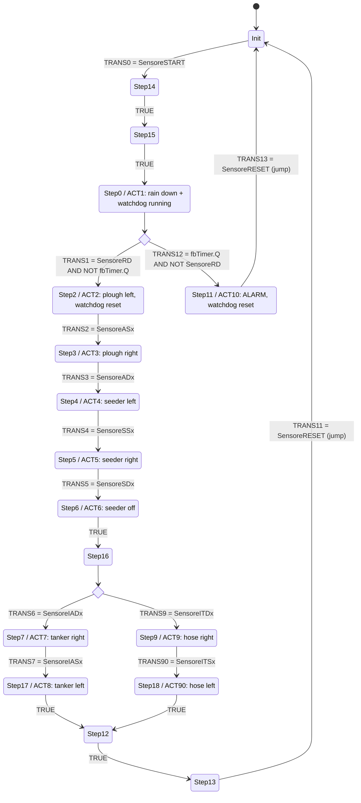

# 02 - SFC structure of `PROGRAM MAIN`

**Source:** `PLC/POUs/MAIN.TcPOU`, `<Implementation><SFC>` block (TwinCAT 3.1.4024, IEC 61131-3 SFC).
**What this is:** the Sequential Function Chart read out of the TwinCAT XML archive and written as a step/transition list plus a Mermaid diagram. Step, transition and action names are the original ones. Nothing was added or renamed.
**Omitted:** the graphical layout data of the chart editor, which can't be rendered outside TwinCAT. No screenshot of the chart is included.

## Overview

The chart has **17 steps** (including the initial step `Init`), **19 transitions**, **2 alternative branches** and **2 jumps** back to `Init`. Every step action uses the `N` (non-stored) qualifier. The action and transition bodies are in Structured Text (11 actions and 14 transition conditions; see `03_actions.st`).

The cycle is: wait for START, then rain, ploughing (left and back), seeding (left and back), and irrigation with either the water tanker or the hose sprinkler. After that the chart waits for RESET and starts over. If the rain does not arrive before the watchdog expires, the chart goes to an alarm step instead.

## Step / transition list (in chart order)

| # | Step | Action (N) | Outgoing transition | Condition |
|---|---|---|---|---|
| 1 | `Init` (initial) | none | TRANS0 | `SensoreSTART` |
| 2 | `Step14` | none | (inline) | `TRUE` |
| 3 | `Step15` | none | (inline) | `TRUE` |
| 4 | `Step0` | ACT1: `ComandoPioggiaMoveDown := TRUE`, watchdog TON running | **Branch2** (alternative), see below | |
| 5 | `Step2` | ACT2: rain off, `ComandoAraturaSx := TRUE`, watchdog reset | TRANS2 | `SensoreASx` |
| 6 | `Step3` | ACT3: plough left off, `ComandoAraturaDx := TRUE` | TRANS3 | `SensoreADx` |
| 7 | `Step4` | ACT4: plough right off, `ComandoSeminaSx := TRUE` | TRANS4 | `SensoreSSx` |
| 8 | `Step5` | ACT5: seeder left off, `ComandoSeminaDx := TRUE` | TRANS5 | `SensoreSDx` |
| 9 | `Step6` | ACT6: `ComandoSeminaDx := FALSE` | (inline) | `TRUE` |
| 10 | `Step16` | none | **Branch3** (alternative), see below | |
| 11 | `Step12` | none (convergence of Branch3) | (inline) | `TRUE` |
| 12 | `Step13` | none | TRANS11 | `SensoreRESET`, then jump to `Init` |

**Branch2: rain delivered or watchdog abort** (alternative divergence after `Step0`)

| Arm | Transition | Condition | Steps | Exit |
|---|---|---|---|---|
| left (normal) | TRANS1 | `SensoreRD AND NOT fbTimer.Q` | none; continues to `Step2` | main sequence |
| right (abort) | TRANS12 | `fbTimer.Q AND NOT SensoreRD` | `Step11`, ACT10: `ComandoALLARME := TRUE`, watchdog reset | TRANS13 `SensoreRESET`, then jump to `Init` |

**Branch3: water tanker or hose sprinkler** (alternative divergence after `Step16`, converging on `Step12`)

| Arm | Entry transition | Steps and actions | Inner transition | Exit |
|---|---|---|---|---|
| left (tanker) | TRANS6 `SensoreIADx` | `Step7` ACT7: `ComandoIrrigazioneAutoDx := TRUE`; `Step17` ACT8: AutoDx off, `ComandoIrrigazioneAutoSx := TRUE` | TRANS7 `SensoreIASx` | `TRUE` to `Step12` |
| right (hose) | TRANS9 `SensoreITDx` | `Step9` ACT9: `ComandoIrrigazioneTuboDx := TRUE`; `Step18` ACT90: TuboDx off, `ComandoIrrigazioneTuboSx := TRUE` | TRANS90 `SensoreITSx` | `TRUE` to `Step12` |

The PLC does not choose between tanker and hose. The C# HMI does: when START is pressed it draws a random number in {0, 1} and sets either `SensoreIADx` or `SensoreITDx`, so each method is chosen with equal probability. The SFC follows whichever arm's entry transition becomes true.

## Notes from the XML

- **Step count:** 17 `SFCStep` elements: `Init, Step14, Step15, Step0, Step11, Step2, Step3, Step4, Step5, Step6, Step16, Step7, Step17, Step9, Step18, Step12, Step13`. The numbering skips `Step1`, `Step8` and `Step10`, and the highest number is `Step18`.
- **Transitions:** 19 `SFCTransition` elements. 13 use a named ST transition (`TRANS0`-`TRANS7`, `TRANS9`, `TRANS90`, `TRANS11`-`TRANS13`) and 6 are inline `TRUE`.
- `TRANS10` (`SensoreEND`) is defined as a transition object but is not placed in the chart.
- `Step0` is the only step that runs the watchdog timer. Two actions reset it: `ACT2`, when the sequence moves on normally, and `ACT10`, on abort. See `04_watchdog.st`.
- The implicit SFC flags (`SFCInit`, `SFCReset`, `SFCError`, ...) are declared but not used (`Use = false`). The reset path is modelled explicitly with the `SensoreRESET` transitions and the jumps to `Init`.
